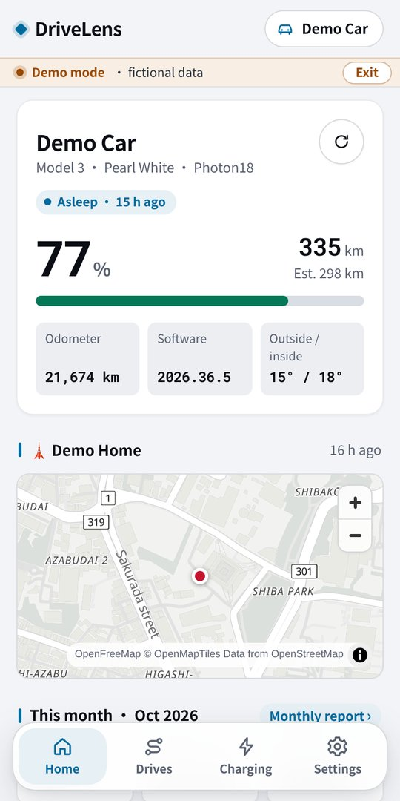
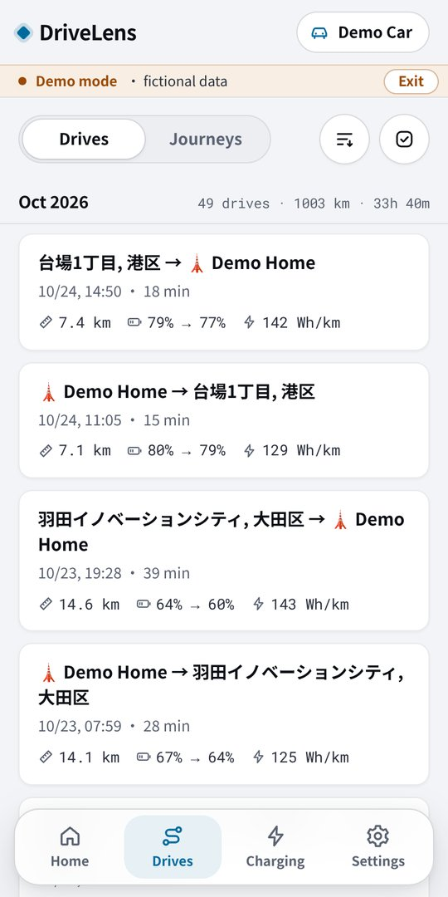
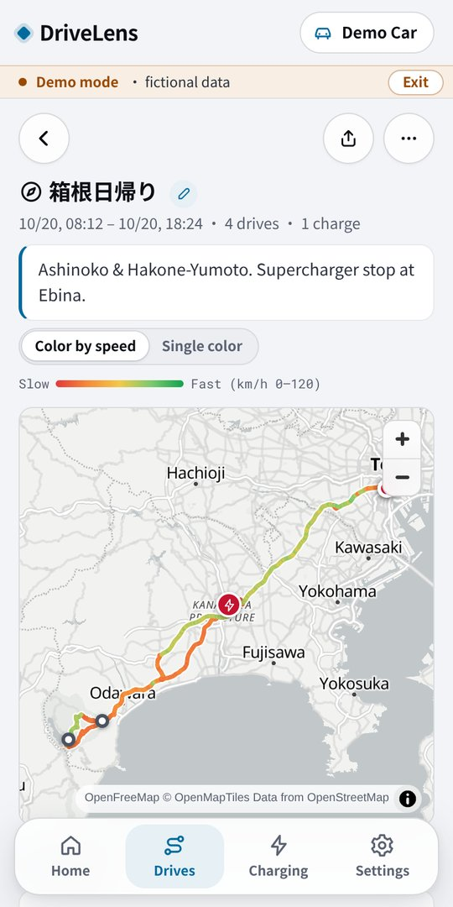
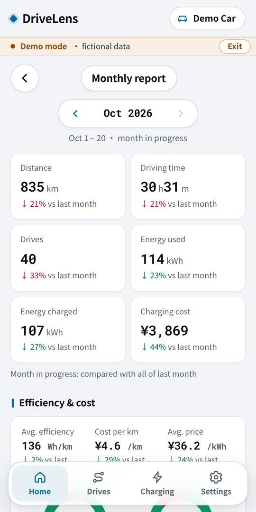
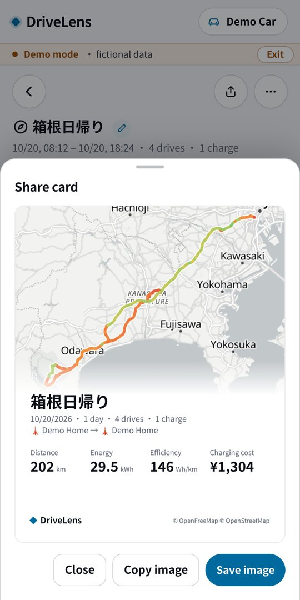
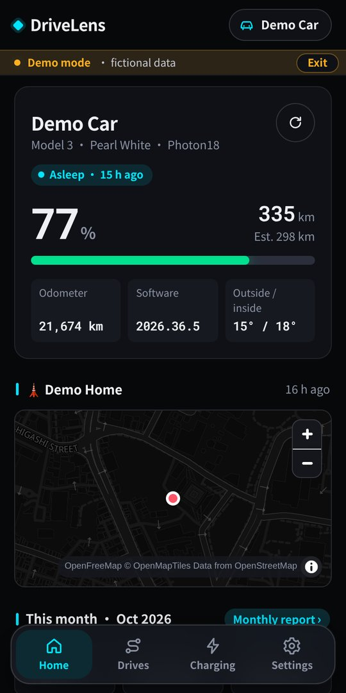

# DriveLens

**English** · [中文](README.zh.md) · [日本語](README.ja.md)

[](https://buymeacoffee.com/zzflsxygod)
[](LICENSE)

DriveLens is a companion app for [TeslaMate](https://github.com/teslamate-org/teslamate). A small read-only API on your own server (**drivelens-api**) reads your TeslaMate database, and the DriveLens web app shows your car, drives, charging, journeys, monthly reports and battery health in a clean, mobile-first interface.

- **Web app:** [https://drivelens-app.oharuru.com](https://drivelens-app.oharuru.com) (phones and desktops, can be installed to the home screen)
- **Try it without a server:** [demo mode](https://drivelens-app.oharuru.com/?demo) (a fictional car, no server needed)
- **Set up your server:** [install guide](docs/install.md) · [中文](docs/install.zh.md) · [日本語](docs/install.ja.md)
- **What's new:** [CHANGELOG](CHANGELOG.md) · [Releases](https://github.com/zzflsxygod/drivelens/releases)

<p>
  
  
  
</p>
<p>
  
  
  
</p>

<sub>Screenshots from demo mode (fictional data).</sub>

## Features

- **Home:** state of charge, range, odometer, software version, temperatures, location on a map, this month at a glance
- **Drives and charging:** infinite lists, route maps coloured by speed, charging curves, weather per drive, energy by speed band
- **Journeys:** group drives into trips (with suggestions), cover photo and notes, share card
- **Monthly report:** distance, energy, charging cost, home vs. Supercharger, daily breakdown, footprint map, 12-month trends
- **Battery health:** health %, usable capacity now / new (kWh), degradation and charge cycles, calculated the same way as TeslaMate's Battery Health dashboard
- **Notifications:** a trip summary when a drive ends and a monthly-report reminder on the 1st (web push, sent by your own server)
- **Your names and costs:** rename places, enter charging costs manually in any currency
- English, 中文, 日本語 · light and dark themes · demo mode

## How it works

```
DriveLens web app  ──https + token──>  drivelens-api (your server)  ──read-only──>  TeslaMate PostgreSQL
```

- The web app talks **directly to your server**. It is only static files; there is no DriveLens backend in between.
- drivelens-api logs in with a **read-only** database account and **never modifies TeslaMate's tables**. DriveLens' own data (place names, costs, journeys, push subscriptions, weather cache) lives in a separate `drivelens` schema.
- The server image `ghcr.io/zzflsxygod/drivelens-api` is public for linux/amd64 and linux/arm64.
- The web app needs an **https** address for your server: Cloudflare Tunnel or `tailscale serve`.

## Quick start (server)

Requirements: TeslaMate running with Docker Compose, on an x86_64 or ARM64 machine.

```bash
cd teslamate   # the directory with TeslaMate's docker-compose.yml
curl -fsSLO https://raw.githubusercontent.com/zzflsxygod/drivelens/main/deploy/setup.sql
curl -fsSLO https://raw.githubusercontent.com/zzflsxygod/drivelens/main/deploy/docker-compose.drivelens.yml
echo "DRIVELENS_DB_PASS=$(openssl rand -hex 16)"  >> .env
echo "DRIVELENS_API_TOKEN=$(openssl rand -hex 24)" >> .env
source .env
docker compose exec -T database psql -U teslamate -d teslamate -v ro_pass="$DRIVELENS_DB_PASS" < setup.sql
docker compose -f docker-compose.yml -f docker-compose.drivelens.yml up -d drivelens-api
```

Then give the server an https address ([Cloudflare Tunnel](docs/install.md#cloudflare-tunnel) or [Tailscale](docs/install.md#tailscale)), open [https://drivelens-app.oharuru.com](https://drivelens-app.oharuru.com) and enter that address and `DRIVELENS_API_TOKEN`. The [install guide](docs/install.md) explains every step.

The official web app at [https://drivelens-app.oharuru.com](https://drivelens-app.oharuru.com) is the supported way to use DriveLens; self-hosting the web app is not officially supported. Unofficial, untested notes for LAN-only use: [install guide appendix](docs/install.md#lan-selfhost).

## Privacy

- Your server URL and token are stored only in your browser and are sent **only to your own server**. DriveLens will never add a feature that sends them anywhere else.
- No telemetry, analytics or tracking.
- Details: [SECURITY.md](SECURITY.md).

## Support

DriveLens is built by one person and is free. If it is useful to you, you can [buy me a coffee](https://buymeacoffee.com/zzflsxygod) ☕.

## Contributing

Bug reports and ideas: [Issues](https://github.com/zzflsxygod/drivelens/issues). Please open an issue before working on a new feature; small fixes can go straight to a pull request. Commits need a DCO `Signed-off-by` line. See [CONTRIBUTING.md](CONTRIBUTING.md) for running the API and the app locally. Longer development notes: [docs/DEVELOPMENT.md](docs/DEVELOPMENT.md). Security problems: please report them privately ([SECURITY.md](SECURITY.md)).

## License

Copyright (C) 2026 zzflsxygod. DriveLens is free software under the [GNU AGPL-3.0-or-later](LICENSE). If you run a modified version as a network service, you must offer its source code to its users. Forks should use a different name and logo.

DriveLens is an independent project, not affiliated with Tesla, Inc. or the TeslaMate project. Maps © [OpenFreeMap](https://openfreemap.org) / © [OpenStreetMap](https://www.openstreetmap.org/copyright) contributors. Weather data by [Open-Meteo](https://open-meteo.com).

The battery-health calculation is derived from [TeslaMate](https://github.com/teslamate-org/teslamate)'s Grafana dashboard (Copyright (C) TeslaMate contributors, AGPL-3.0-or-later; modified, see [third_party/teslamate/NOTICE](third_party/teslamate/NOTICE)). The demo routes (`app/src/demo/routes.json`) are © OpenStreetMap contributors under the [ODbL](https://opendatacommons.org/licenses/odbl/), with elevation from the Copernicus DEM via Open-Meteo ([CC BY 4.0](https://creativecommons.org/licenses/by/4.0/)). Licenses of bundled third-party libraries: [api/THIRD_PARTY_LICENSES.txt](api/THIRD_PARTY_LICENSES.txt) (server) and `/third-party-licenses.txt` in the web app.
