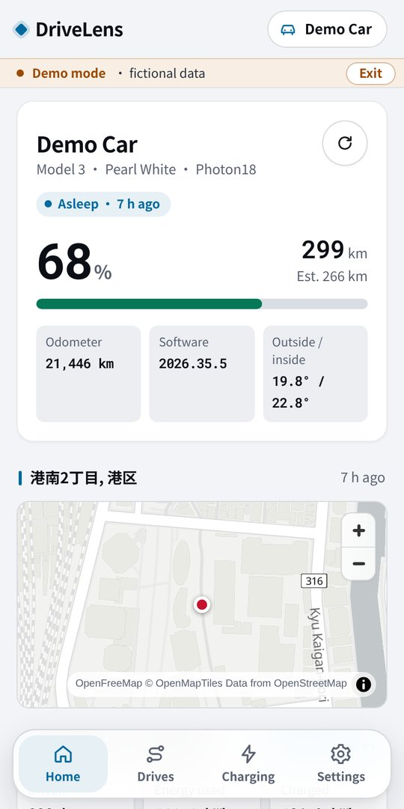
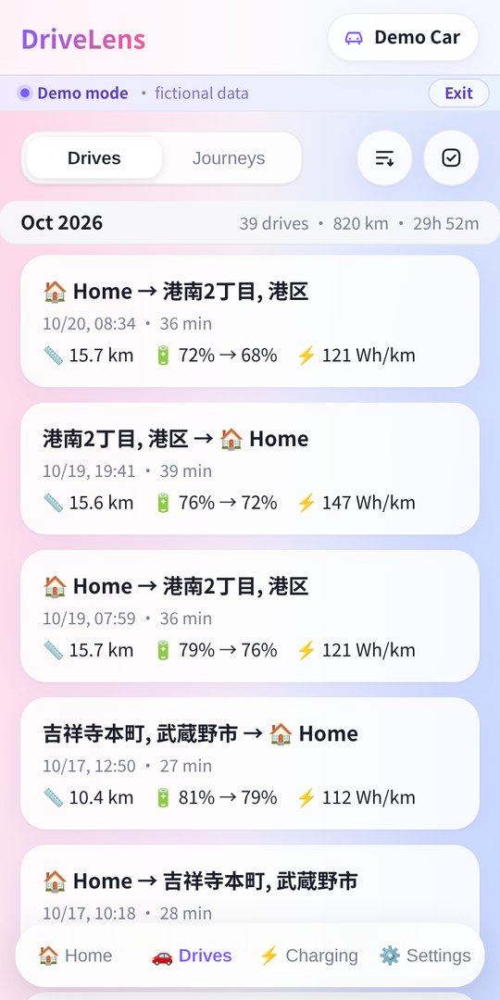
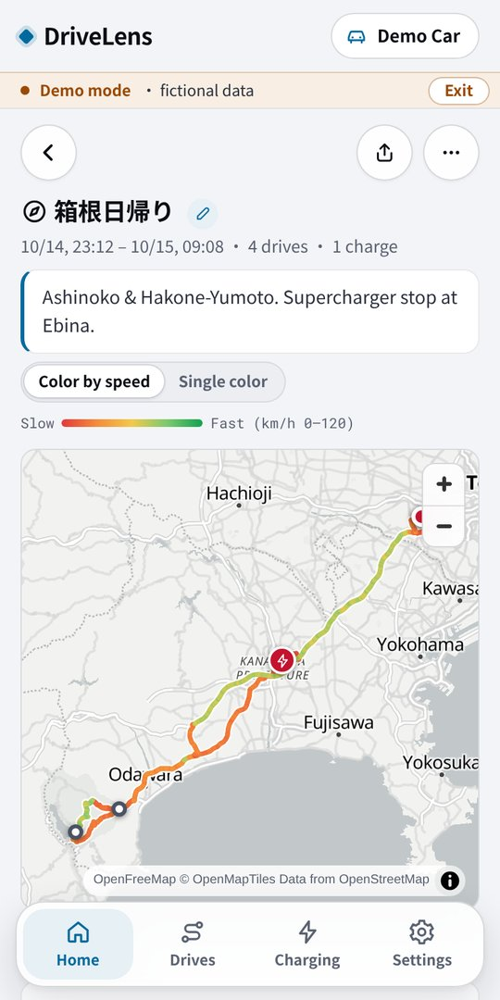
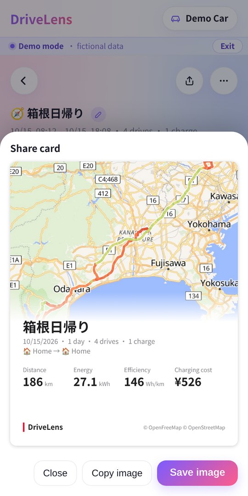
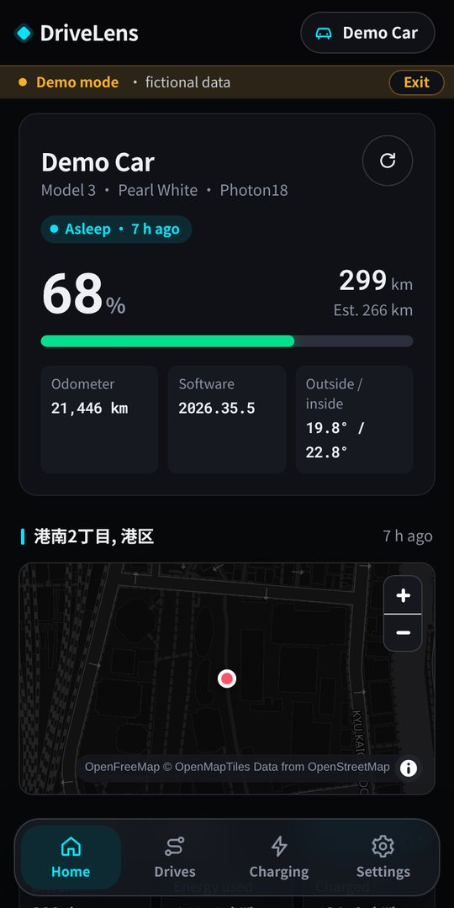

# DriveLens

[English](README.md) · **中文** · [日本語](README.ja.md)

[](https://buymeacoffee.com/zzflsxygod)
[](LICENSE)

DriveLens 是 [TeslaMate](https://github.com/teslamate-org/teslamate) 的第三方应用。你自己服务器上的一个小型只读 API（**drivelens-api**）读取 TeslaMate 数据库，DriveLens 网页版用简洁的、以手机为主的界面展示车辆状态、行程、充电、旅程、月度报告和电池健康度。

- **网页版：** https://drivelens-app.oharuru.com （手机、电脑都能用，可以添加到主屏幕）
- **没有服务器也能试用：** [演示模式](https://drivelens-app.oharuru.com/?demo)（虚构的车辆，不需要服务器）
- **部署服务器：** [安装指南](docs/install.zh.md) · [English](docs/install.md) · [日本語](docs/install.ja.md)
- **更新内容：** [CHANGELOG](distribution/CHANGELOG.md)（英文）· [Releases](https://github.com/zzflsxygod/drivelens/releases)

<p>
  
  
  
</p>
<p>
  
  
  
</p>

<sub>截图来自演示模式（虚构数据）。</sub>

## 功能

- **首页：** 电量、续航、里程表、软件版本、车内外温度、地图上的当前位置、本月概览
- **行程和充电：** 无限滚动列表、按速度着色的路线地图、充电曲线、每次行程的天气、各速度区间的能耗
- **旅程：** 把多次行程合并成一次旅程（会自动推荐），可加封面和备注，生成分享卡片
- **月度报告：** 里程、电量、充电费用、家充 / 超充占比、每日明细、足迹地图、12 个月趋势
- **电池健康度：** 健康度 %、当前 / 新车可用容量（kWh）、衰减和充电循环次数，算法与 TeslaMate 的 Battery Health 看板相同
- **通知：** 行程结束时推送行程摘要，每月 1 日推送月度报告提醒（网页推送，由你自己的服务器发送）
- **自定义名称和费用：** 给地点改名，手动录入充电费用（任意币种）
- 中文 / English / 日本語 · 浅色和深色主题 · 演示模式

## 工作方式

```
DriveLens 网页版  ──https + Token──>  drivelens-api（你的服务器）  ──只读──>  TeslaMate PostgreSQL
```

- 网页版**直接连接你的服务器**。它只是静态文件，中间没有任何 DriveLens 后台。
- drivelens-api 用**只读**数据库账号登录，**绝不修改 TeslaMate 的表**。DriveLens 自己的数据（地点名称、费用、旅程、推送订阅、天气缓存）放在独立的 `drivelens` schema 里。
- 服务器镜像 `ghcr.io/zzflsxygod/drivelens-api` 公开提供 linux/amd64 和 linux/arm64 版本。
- 网页版要求服务器有 **https** 地址：用 Cloudflare Tunnel 或 `tailscale serve`。

## 快速开始（服务器）

前提：TeslaMate 用 Docker Compose 运行，机器是 x86_64 或 ARM64。

```bash
cd teslamate   # TeslaMate 的 docker-compose.yml 所在目录
curl -fsSLO https://raw.githubusercontent.com/zzflsxygod/drivelens/main/deploy/setup.sql
curl -fsSLO https://raw.githubusercontent.com/zzflsxygod/drivelens/main/deploy/docker-compose.drivelens.yml
echo "DRIVELENS_DB_PASS=$(openssl rand -hex 16)"  >> .env
echo "DRIVELENS_API_TOKEN=$(openssl rand -hex 24)" >> .env
source .env
docker compose exec -T database psql -U teslamate -d teslamate -v ro_pass="$DRIVELENS_DB_PASS" < setup.sql
docker compose -f docker-compose.yml -f docker-compose.drivelens.yml up -d drivelens-api
```

然后给服务器配一个 https 地址（[Cloudflare Tunnel](docs/install.zh.md#cloudflare-tunnel) 或 [Tailscale](docs/install.zh.md#tailscale)），打开 https://drivelens-app.oharuru.com ，填入这个地址和 `DRIVELENS_API_TOKEN`。每一步的说明见[安装指南](docs/install.zh.md)。

DriveLens 的使用方式是官方网页版 https://drivelens-app.oharuru.com ；自行部署网页版不在官方支持范围内。

## 隐私

- 服务器地址和 Token 只保存在你的浏览器里，**只会发送到你自己的服务器**。DriveLens 不会增加任何把它们发到别处的功能。
- 没有遥测、统计或追踪。
- 详见 [SECURITY.md](SECURITY.md)（英文）。

## 支持

DriveLens 由一个人开发维护，免费使用。如果对你有帮助，可以[请我喝杯咖啡](https://buymeacoffee.com/zzflsxygod) ☕。

## 参与贡献

问题和建议请提交到 [Issues](https://github.com/zzflsxygod/drivelens/issues)。做新功能之前请先开 Issue 讨论，小修复可以直接提 PR。每个 commit 需要 DCO `Signed-off-by`。本地运行 API 和 App 的方法见 [CONTRIBUTING.md](CONTRIBUTING.md)（英文）。安全问题请私下报告（[SECURITY.md](SECURITY.md)）。

## 许可证

Copyright (C) 2026 zzflsxygod。DriveLens 是自由软件，采用 [GNU AGPL-3.0-or-later](LICENSE) 许可。如果你把修改后的版本作为网络服务提供，必须向其用户提供源代码。Fork 请使用不同的名称和图标。

DriveLens 是独立项目，与 Tesla, Inc. 及 TeslaMate 项目无关。地图 © [OpenFreeMap](https://openfreemap.org) / © [OpenStreetMap](https://www.openstreetmap.org/copyright) 贡献者。天气数据来自 [Open-Meteo](https://open-meteo.com)。
