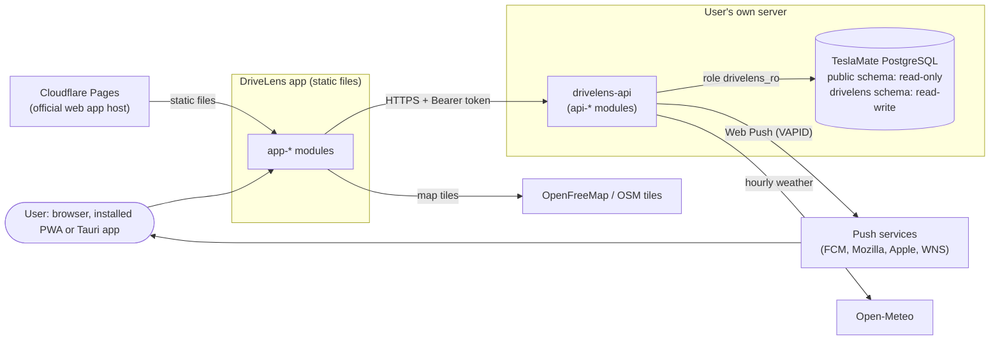
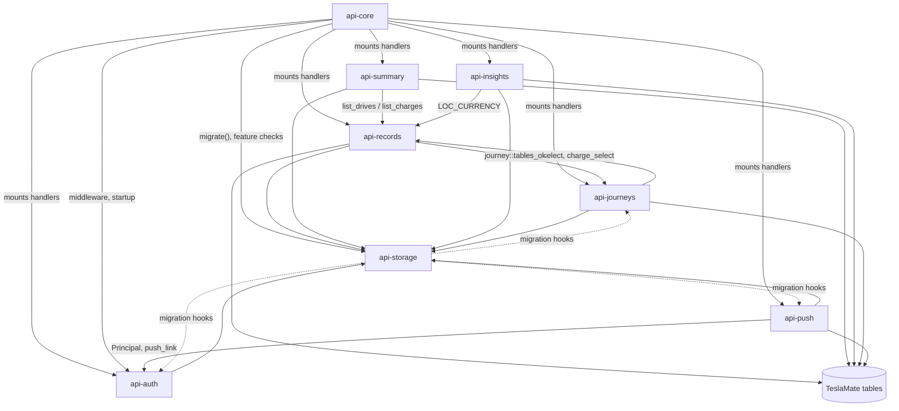
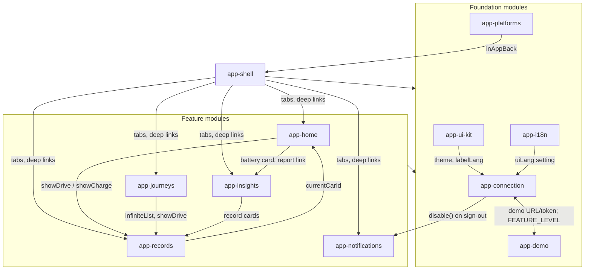

# DriveLens specifications — overview

> Reverse-engineered from `main` @ 9b1c39c (app v1.2.2, drivelens-api 0.14.0, API level 15).
> This file lists the 20 module specs, shows how the modules depend on each other, and collects the
> cross-cutting rules and the issues that span several modules.

## 1. How to read the specs

Each module has one file, `specs/<module>/SPEC.md`, with the same seven sections:

1. **Goal**: why the module exists.
2. **Responsibility boundaries**: what is in scope, what belongs to other modules, and the module's interfaces and dependencies.
3. **External behavior**: numbered, verifiable statements in the form "When X, the system SHALL Y".
4. **Key design decisions**
5. **Constraints**
6. **Non-goals**
7. **Current behavior vs. intended behavior**: suspected bugs, inconsistencies and legacy leftovers. These are kept out of sections 3–6.

Conventions used in every spec:

- **Statement IDs.** Each statement has a module prefix and a number, for example `AUTH-012`. The prefixes are listed in the module table in section 3.
- **Evidence.** Every statement ends with its source:
  - `src:` a code location, at this commit, as `path:line` or `path:start-end`
  - `test:` an automated test that asserts the statement
  - `doc:` README, CHANGELOG, `docs/install*.md`, SECURITY.md or CONTRIBUTING.md
  - `comment:` a code comment that states intent
- **Plain statements** describe behavior that the code shows unambiguously.
- **Review markers (2026-10-26).** The first draft marked inferred statements `[TO CONFIRM]`. The review against 9b1c39c replaced every such mark with one of:
  - *Confirmed from code* — checked in this repository (or in a dependency's source, which is then named).
  - *Confirmed (owner decision)* — follows a rule the owner has set (for example: TeslaMate tables are never modified, native builds are paused).
  - *Confirmed (current scope / design)* — the reviewer's reading of the current scope or design rationale; the owner may still change it.
  - **[OWNER DECISION NEEDED]** — only the owner can decide; the spec states the question and a recommendation.
  New statements that rest on inference may again be marked `[TO CONFIRM]`.
- **"The system"** means the subject named in each spec's header.
- **CB rows.** Section 7 rows are numbered `CB-n` within each spec. Each row gives the current behavior with its evidence, why it looks unintended, how confident the writer is, and the presumed intent, followed by a **Review** verdict: *real issue, verified at 9b1c39c; not fixed in this PR*, *not a bug* (with the reason), or **[OWNER DECISION NEEDED]**. Code fixes for real issues are separate PRs.

## 2. System context

- The app talks directly to the user's own server. There is no DriveLens backend in between. (doc: README.md "How it works")
- The API never writes TeslaMate's tables. DriveLens' own data lives in the `drivelens` schema. (doc: README.md "How it works"; comment: deploy/setup.sql:7-15)
- The server URL and token are stored only on the device and are sent only to that server. (doc: README.md "Privacy"; doc: SECURITY.md)
- Schema changes: drivelens-api creates and upgrades its own `drivelens` tables at startup (`migrate()` and the per-module hooks, see api-storage); `deploy/setup.sql` is the one-time, hand-run script for the role, privileges and schema. Process rule (owner): a change that needs SQL run by the database admin is handed to the owner as SQL before anything is pushed.

## 3. Modules

| # | Module | Prefix | Responsibility | Main sources | SHALL | TO CONFIRM (resolved) | CB |
|---|--------|--------|----------------|--------------|------:|------:|---:|
| 1 | [api-core](api-core/SPEC.md) | CORE | Process startup and env config, route table, CORS, JSON error format, `/health` and `/api/health`, `API_LEVEL`, startup feature log | `api/src/main.rs` | 39 | 9 | 4 |
| 2 | [api-storage](api-storage/SPEC.md) | STOR | `drivelens_ro` role and privileges, the API's own schema migration, per-feature availability checks that turn a feature off instead of failing | `deploy/*.sql`, `migrate()` and each module's migration hook | 46 | 7 (1 owner question open) | 6 |
| 3 | [api-auth](api-auth/SPEC.md) | AUTH | Owner key, `dlt_` device tokens, pairing codes, full/read scopes, owner-key mode, failure limits, client-IP keys, auth middleware, `/api/auth/*` | `api/src/auth.rs` | 68 | 5 | 3 |
| 4 | [api-records](api-records/SPEC.md) | REC | Cars, drives, charges (cursor paging, charging-power fallback, currency guess), drive paths, month totals, place aliases, manual costs | `api/src/main.rs` | 55 | 10 | 5 |
| 5 | [api-summary](api-summary/SPEC.md) | SUM | Home data: car status, last activity, stats | `api/src/summary.rs` | 23 | 7 | 3 |
| 6 | [api-insights](api-insights/SPEC.md) | INS | Monthly report, 12-month trends, footprint, battery health | `api/src/report.rs`, `api/src/insights.rs` | 75 | 14 | 8 |
| 7 | [api-journeys](api-journeys/SPEC.md) | JRN | Journeys and their drives, suggestions and dismissal, path, cover, weather, speed bands | `api/src/journey.rs`, `api/src/phase2.rs` | 80 | 16 | 7 |
| 8 | [api-push](api-push/SPEC.md) | PUSH | VAPID keys, subscriptions, trip and monthly notifications, delivery limits | `api/src/push.rs` | 57 | 6 | 3 |
| 9 | [app-shell](app-shell/SPEC.md) | SHELL | Startup order, tabs, car selection, theme, back stack, Settings screen layout, banners, feature gating, deep links | `app/src/main.ts`, `nav.ts`, `links.ts`, part of `platform.ts` | 85 | 5 | 4 |
| 10 | [app-ui-kit](app-ui-kit/SPEC.md) | UI | Popovers, sheets, toolbar, back-to-top, overlay scrollbar, icons, design tokens, `DriveMap` | `ui.ts`, `sheets.ts`, `toolbar.ts`, `totop.ts`, `scrollbar.ts`, `icons.ts`, `palette.ts`, `map.ts`, `style.css` | 80 | 3 | 2 |
| 11 | [app-connection](app-connection/SPEC.md) | CONN | Settings storage, `api()` request layer, setup wizard, server version and feature levels, URL privacy guard, device auth client, Settings › Devices, sign-out | `api.ts`, `setup.ts`, `version.ts`, `urlguard.ts`, `auth.ts`, `devices.ts` | 86 | 7 | 4 |
| 12 | [app-home](app-home/SPEC.md) | HOME | Home screen and its snapshot cache | `app/src/main.ts` (`showHome`) | 38 | 6 | 3 |
| 13 | [app-records](app-records/SPEC.md) | AREC | Infinite list, drive detail, Charges tab and charge detail, rename and cost dialogs | `infinite.ts`, `app/src/main.ts` | 55 | 8 | 4 |
| 14 | [app-journeys](app-journeys/SPEC.md) | AJRN | Drives tab (drive list, select mode), journeys, suggestions, cover, share card, weather, speed bands | `journey.ts`, `journey2.ts` | 70 | 9 | 4 |
| 15 | [app-insights](app-insights/SPEC.md) | AINS | Report page, footprint, trends, battery page, Home battery card | `report.ts`, `insights.ts`, part of `main.ts` | 59 | 11 | 5 |
| 16 | [app-notifications](app-notifications/SPEC.md) | NOTIF | Notification settings and the service worker's push and click handling | `notify.ts`, `swSource` in `vite.config.ts` | 40 | 6 | 3 |
| 17 | [app-i18n](app-i18n/SPEC.md) | I18N | zh/en/ja strings, formatting, language choice, `check-i18n` build check | `i18n.ts`, `locales/*.ts`, `scripts/check-i18n.mjs` | 40 | 8 | 2 |
| 18 | [app-demo](app-demo/SPEC.md) | DEMO | Demo mode: fixed fictional dataset, in-browser mock API, request interception, separate storage keys | `demo.ts`, `demo/*` | 70 | 10 | 5 |
| 19 | [app-platforms](app-platforms/SPEC.md) | PLAT | PWA (service worker, manifest, install, update) and Tauri shells (CSP, Android bridge) | `pwa.ts`, `platform.ts`, `vite.config.ts`, `src-tauri/**` | 51 | 5 | 2 |
| 20 | [ops-delivery](ops-delivery/SPEC.md) | OPS | Docker image, compose, systemd unit, CI, release scripts, license checks, test fixtures | `api/Dockerfile`, `deploy/`, `.github/`, `scripts/`, `testdata/` | 56 | 9 (1 owner question open) | 5 |
| | **Total** | | | | **1173** | **161 (2 owner questions open)** | **82** |

Module boundaries on the app side are **logical, not file boundaries**. `app/src/main.ts` holds code for `app-shell`, `app-home`, `app-records`, `app-insights` and `app-notifications`. Each spec names the functions it covers.

## 4. Dependencies

An arrow `A → B` means that A calls, reads or otherwise depends on B. The per-spec section 2.3 gives each dependency's reason, with evidence.

### 4.1 Server (drivelens-api)

| Module | Depends on | Used by |
|--------|-----------|---------|
| api-core | api-storage, api-auth, api-push, the handler modules (mounting) | every api-* module (shared `AppState`, `ApiError`, `bad()`, `paged()`, `TS`); app-connection (`/health`); ops-delivery |
| api-storage | PostgreSQL catalogs; each module's migration hook (`journey::try_create_tables`, `phase2::try_migrate`, `push::try_migrate`, `auth::try_migrate`) | api-core, api-auth, api-records, api-summary, api-insights, api-journeys, api-push; ops-delivery (`setup.sql`) |
| api-auth | api-core, api-storage | api-core (middleware on all `/api/*` except `POST /api/auth/pair`), api-push, app-connection |
| api-records | api-core, api-storage, api-journeys (`tables_ok` adds `journey_id`/`journey_name` to drives), TeslaMate tables | api-summary, api-insights, api-journeys, app-home, app-records, app-journeys, app-connection (`GET /api/cars` as connection check) |
| api-summary | api-core, api-storage, api-records, TeslaMate tables | app-home |
| api-insights | api-core, api-storage, api-records, TeslaMate tables, PostgreSQL time zones | app-insights |
| api-journeys | api-core, api-storage, api-records, TeslaMate tables, Open-Meteo | api-records, app-journeys |
| api-push | api-core, api-storage, api-auth, TeslaMate tables, push services | app-notifications |

The read-only scope is enforced once, in the auth middleware. A device with `read` scope gets `403` with code `read_only` for any method other than GET/HEAD. The exceptions are `/api/push/*` and renaming or deleting its own entry at `/api/auth/devices/current`. (src: api/src/auth.rs:455-464; test: api/src/main.rs auth_tests::db_device_flow)

### 4.2 App (web / Tauri)

| Module | Depends on | Used by |
|--------|-----------|---------|
| app-shell | app-connection, app-ui-kit, app-i18n, app-demo, app-platforms, app-notifications, app-home, app-records, app-journeys, app-insights; Tauri API, browser history and storage | app-journeys (`Ctx`, `navPage`), app-insights (`ReportNav`), app-records (`navPage`, `showBanner`), app-connection (`leftServer`), app-platforms (`popPage`, `inAppBack`) |
| app-ui-kit | app-connection (`theme`, `labelLang`), app-i18n, app-platforms (touch/IME classes, Android insets); maplibre-gl, OpenFreeMap, OSM tiles | all screen modules, app-shell, app-connection |
| app-connection | api-core, api-auth, api-records (`/api/cars`), app-i18n, app-demo, app-notifications, app-ui-kit, app-platforms, app-shell; browser `fetch`, storage, `navigator.locks` | every other app module (`api()`, settings, `lacks()`, `canWrite()`); app-demo (`FEATURE_LEVEL`, `LATEST_SERVER`) |
| app-home | api-summary, api-records, app-insights, app-records, app-connection, app-shell, app-ui-kit, app-i18n, app-demo | app-shell, app-records (`currentCarId`), app-insights (hosts the battery card) |
| app-records | api-records, app-connection, app-shell, app-home, app-ui-kit, app-i18n, app-demo | app-shell, app-home, app-journeys, app-insights |
| app-journeys | api-journeys, api-records (`/api/drives`), app-connection, app-records, app-ui-kit, app-shell, app-platforms (share/save bridge), app-i18n | app-shell |
| app-insights | api-insights, app-connection, app-shell, app-records, app-home, app-ui-kit, app-i18n, app-demo | app-home, app-shell (`?view=report:…`, `?view=battery`), app-notifications (monthly push opens the report) |
| app-notifications | api-push, app-connection, app-demo, app-platforms (service worker), app-shell (`openView`), app-i18n, app-ui-kit; browser Push/Notification APIs | app-shell, app-connection |
| app-i18n | app-connection (reads and migrates `drivelens-settings`); browser `Intl`, `navigator.languages` | every app module; ops-delivery (build check) |
| app-demo | app-connection; the response shapes of every api-* module it mirrors; OSRM and Open-Meteo at build time only | app-connection, app-shell, app-records, app-insights, app-notifications, app-platforms |
| app-platforms | app-shell, app-ui-kit, app-i18n, app-connection (sensitive URL parameters), app-demo (license text, precached chunk); Vite, Tauri 2, Android SDK | app-shell, app-connection, app-journeys, app-notifications, ops-delivery |

The app modules depend on each other in both directions in several places: app-shell ↔ app-connection, app-home ↔ app-records, app-home ↔ app-insights and app-connection ↔ app-demo. Splitting these cycles is not a goal of these specs; they are recorded as found.

### 4.3 App → server contract

| App module | Server module | Endpoints |
|-----------|---------------|-----------|
| app-connection | api-core | `GET /health`, `GET /api/health` |
| app-connection | api-auth | `/api/auth/me`, `/api/auth/devices*`, `/api/auth/pairings`, `/api/auth/pair` |
| app-connection | api-records | `GET /api/cars` (connection check) |
| app-home | api-summary | `GET /api/cars/{id}/status`, `/last-activity`, `/stats` |
| app-home, app-shell | api-records | `GET /api/cars` |
| app-records | api-records | `/api/drives*`, `/api/charges*`, `/api/cars/{id}/months`, `/api/addresses/*` |
| app-journeys | api-journeys, api-records | `/api/journeys*`, `GET /api/drives` |
| app-insights | api-insights | `GET /api/cars/{id}/report`, `/trends`, `/footprint`, `/battery` |
| app-notifications | api-push | `/api/push/key`, `/subscription`, `/subscription/status`, `/unsubscribe`, `/test` |
| app-demo | (all of the above, mocked in the browser) | every endpoint the app calls; `GET /api/cars/{id}/summary` and `/api/push/*` are not mocked (see app-demo CB-1) |

### 4.4 Delivery

`ops-delivery` builds and ships `api-core`'s binary (Docker image, compose file, `setup.sql` from `api-storage`). It also builds `app-platforms`' outputs: the web bundle for Cloudflare Pages and the Tauri builds. Both app builds run `app-i18n`'s `check-i18n`.

## 5. Cross-cutting rules

### 5.1 Version contract: `API_LEVEL` ↔ `FEATURE_LEVEL`

The server reports one integer `api_level` on `/health`. The app turns individual features off when the level is too low. (src: api/src/main.rs:300-303; src: app/src/version.ts:8-10, 52)

| Level | Server release | Feature | App key |
|------:|---------------|---------|---------|
| 3 | v0.3.1 | split Home endpoints (app minimum) | `MIN_API_LEVEL` |
| 4 | v0.3.2 | charge `power_kw` | `chargePower` |
| 5 | v0.4.0 | manual charge costs | `costs` |
| 6 | v0.5.0 | monthly report | `report` |
| 7 | v0.5.1 | JSON `/health` with version | — |
| 8 | v0.6.0 | journeys | `journeys` |
| 9 | v0.6.1 | suggestion dismissal | `dismiss` |
| 10 | v0.6.2 | keyset paging, `/cars/{id}/months` | `paging` |
| 11 | v0.7.0 | journey cover, weather, speed bands | `journey2` |
| 12 | v0.9.0 | battery degradation, footprint, trends | `insights` |
| 13 | v0.12.0 | web push | `push` |
| 14 | v0.13.0 | TeslaMate-identical battery health | `tmHealth` |
| 15 | v0.14.0 | device auth | `devices` |
| 16 | v0.15.0 (unreleased batch) | place search (`q`) + car status TPMS | `driveSearch`, `tpms` |

`tmHealth` is declared but no app code reads it; the app detects the TeslaMate method from the `tm` field of `/battery` (see app-insights). (src: app/src/version.ts:10)

### 5.2 Degrade instead of fail

Every optional `drivelens` table is checked at runtime. A missing or unwritable table turns its feature off, usually with `503` and a setup hint, while the rest of the API keeps working. `/api/health` and the startup log report which features are on. The app reads the same signals and hides what is unavailable. See api-storage section 3 and app-shell section 3. CB-1 under section 6 below lists the exceptions.

### 5.3 Authentication and read-only devices

All `/api/*` routes pass the auth middleware except `POST /api/auth/pair`. (test: api/src/main.rs auth_tests::only_pair_is_public) On the server, read-only devices are limited as described in section 4.1. The app hides editing entry points through `canWrite()`. See api-auth and app-connection.

### 5.4 Privacy

- Tokens travel only in the `Authorization` header, to the user's own server.
- `?api=`, `?token=` and `?key=` are stripped from the address before any other code runs.
- The service worker never intercepts or caches API requests or map tiles.

(doc: README.md "Privacy"; src: app/src/urlguard.ts; comment: app/vite.config.ts:63-64; src: app/vite.config.ts:76-78) See app-connection and app-platforms.

### 5.5 Demo mode mirrors the API

Demo mode answers API requests in the browser from a generated dataset, with its own storage namespace. It copies the server's response shapes by hand; no test checks that the two stay in sync. See app-demo CB-1 and CB-2.

## 6. Issues that span modules

These summarize section 7 rows that appear in more than one spec or affect more than one module, plus one notable single-module finding of the review (X-11). The second column is the review verdict at 9b1c39c; X-2, X-8 and X-11 were fixed in v1.2.3 / API 0.14.1 and X-10 in the docs on 2026-10-26; the others are open. Each item links to the rows that hold the evidence.

| # | Summary | Review verdict | Rows |
|---|---------|-----------|------|
| X-1 | Queries for drives, charges, the report, trends and journeys always join `drivelens.address_aliases`. Without that table they return 500, although docs say the read features keep working. `api-push` checks for the table first. | real, rare in practice | api-storage CB-1, api-insights CB-8 |
| X-2 | A database error in the table probe (`tables_ok`) of the 5-minute device reload marks device auth unavailable and clears the device index. Every device token then gets 401, and the app deletes its saved connection on 401, so a short outage can sign out every device. This contradicts the comment at `api/src/auth.rs:342`. The next successful reload restores the index, but apps that saw the 401 have already deleted their credentials. | real, notable (`api/src/auth.rs:96-102`, `:344-349`); **fixed in v1.2.3 / API 0.14.1** | api-auth CB-1 |
| X-3 | `DELETE /api/charges/{id}/cost` and `DELETE /api/addresses/{id}/alias` cast the id with `as i32` without an existence check. An id above 2^31 wraps around and can delete another record's cost or alias. | real, low severity (needs an authenticated full-scope client) | api-records CB-1 |
| X-4 | Setup hints in API errors and in the app still point to legacy `deploy/drivelens-v0.x.sql` files instead of `setup.sql`. | real, text only | api-storage CB-4, api-push CB-1, api-journeys CB-7, app-notifications CB-1 |
| X-5 | Some paths that need missing tables return 500 instead of 503: speed bands and the alias endpoints. | real, minor | api-storage CB-2, CB-3; api-journeys CB-4 |
| X-6 | Trip notifications carry `&car=<id>`, but the app never reads it, so tapping one does not switch the selected car. | real, minor (multi-car only) | app-shell CB-1, app-notifications CB-2 |
| X-7 | On a cold start with several cars, list requests use the car selector (still empty) while cache keys and totals use the remembered car. | real, minor (multi-car cold start only) | app-records CB-4, app-journeys CB-4 |
| X-8 | A journey note cannot be cleared: the API treats `note: null` as "not sent", and the app sends `null` when the note is emptied. | real, user-facing; **fixed in v1.2.3 / API 0.14.1** | api-journeys CB-1, app-journeys CB-1 |
| X-9 | The demo mock differs from the Rust API in several validation rules and response shapes. | real, low impact | app-demo CB-1, CB-2 |
| X-10 | Contributor documentation trails the code: schema changes are now self-migrated, and auth moved to `auth.rs`. | real, documentation; **fixed in docs (2026-10-26, CONTRIBUTING.md, docs/DEVELOPMENT.zh.md, AGENTS.md)** | api-storage CB-5, ops-delivery CB-3 |
| X-11 | `web-push-native` uses the notification validity also as the VAPID JWT `exp`: monthly reminders are signed for 72 h and trip summaries for exactly 24 h, while RFC 8292 caps `exp` at 24 h and push services reject longer tokens. The first monthly reminder (2026-11-01) is likely to fail on every push service. | real (confirmed against FCM and Mozilla autopush: 403 / 401); **fixed in v1.2.3 / API 0.14.1** | api-push CB-3, PUSH-075 |

## 7. Coverage and limits

- **Static reading only.** The specs come from reading the code and docs at commit 9b1c39c. Nothing was built or run to produce them. The review also read dependency sources where behavior depended on them (tower-http 0.7 trace defaults, web-push-native 0.5.0 TTL / VAPID) and the GitHub Actions run history for `docker.yml`.
- **Tests.**
  - Server: the automated tests cover CORS, the public/protected route table, the auth helpers and the device flow, and push message texts and encryption. The device flow test runs only when `DRIVELENS_TEST_DATABASE_URL` is set.
  - App: no tests, apart from the `check-i18n` build check.
  - As a result, most app statements are backed by `src:` evidence only.
- **Former `TO CONFIRM` marks (161 counted in the table, 189 occurrences including inline ones).** All were resolved in the 2026-10-26 review; 2 questions remain open for the owner (api-storage CB-6, ops-delivery CB-2 / OPS-030). The original marks clustered in four areas, which remain the least certain parts of the specs:
  - design rationale (why a limit or method was chosen)
  - behavior that depends on TeslaMate, PostgreSQL, browsers or libraries
  - claims of equivalence to TeslaMate's battery-health dashboard
  - CI and platform behavior that was not run
- **Line references** point to commit 9b1c39c. They go stale as the code changes.
